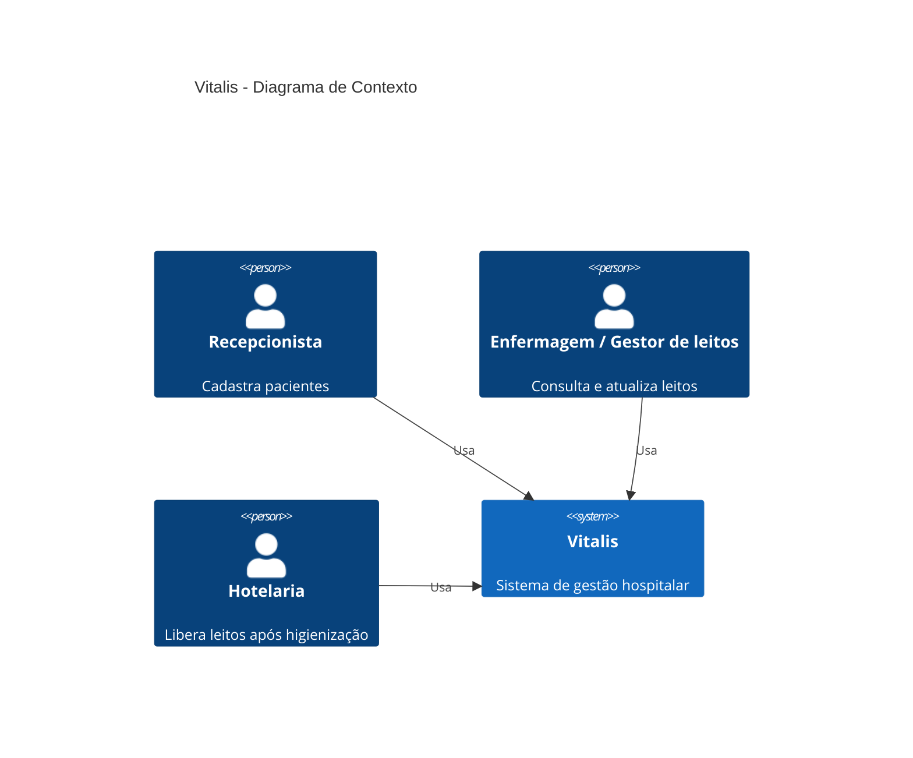
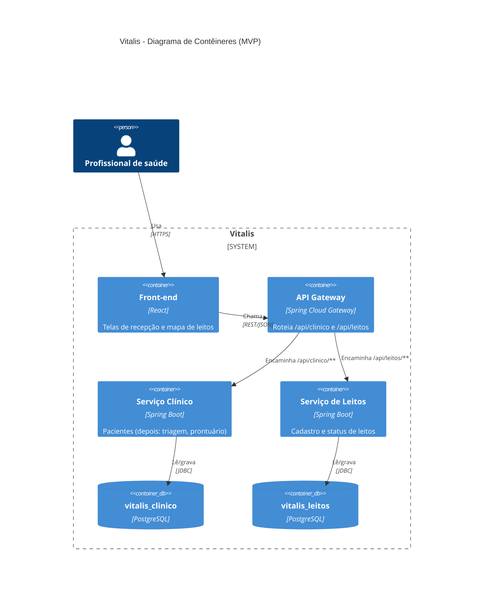

# Arquitetura do Vitalis (MVP)

O MVP cobre o núcleo do fluxo hospitalar: **cadastro de pacientes** e **gestão de leitos**. As funcionalidades de IA (copiloto RAG, predição de sepse), faturamento TISS/TUSS e mensageria assíncrona ficam fora do MVP e entram depois como novos serviços atrás do mesmo gateway.

## Stack

| Camada | Tecnologia | Motivo |
|---|---|---|
| Linguagem | Java 21 | Exigência do roteiro da disciplina |
| Back-end | Spring Boot 3.5 | Exigência do roteiro |
| API Gateway | Spring Cloud Gateway | Ponto único de entrada, roteia por prefixo |
| Persistência | PostgreSQL 17 + Spring Data JPA | Modelo relacional em 3NF da documentação |
| Migrações | Flyway | Schema versionado junto com o código |
| Front-end | React (a fazer) | Permitido pelo roteiro |
| Infra local | Docker Compose | Sobe tudo com um comando |

## C4 — Nível 1: Contexto



## C4 — Nível 2: Contêineres



Cada serviço tem **seu próprio banco** (database-per-service): um serviço nunca acessa as tabelas do outro. No Docker Compose os dois bancos ficam na mesma instância do Postgres para economizar recursos, mas estão isolados.

## C4 — Nível 3: Componentes (dentro de cada serviço)

Os dois serviços seguem a mesma organização por funcionalidade:

```
servico-leitos/src/main/java/br/ucsal/vitalis/leitos/
└── leito/
    ├── Leito.java            # entidade JPA + regra de negócio (alterarStatus)
    ├── StatusLeito.java      # LIVRE, RESERVADO, OCUPADO, EM_HIGIENIZACAO, MANUTENCAO, ISOLAMENTO
    ├── LeitoRepository.java  # Spring Data JPA
    └── LeitoController.java  # endpoints REST
```

Regras de negócio implementadas:
- **Paciente:** CPF válido (dígitos verificadores) e único; CNS opcional com 15 dígitos.
- **Leito:** leito `EM_HIGIENIZACAO` não pode passar direto para `OCUPADO` ou `RESERVADO`; precisa ser liberado antes (retorna HTTP 422).

## Endpoints (via gateway, porta 8080)

| Método | Rota | Descrição |
|---|---|---|
| GET | `/api/clinico/pacientes` | Lista pacientes |
| GET | `/api/clinico/pacientes/{id}` | Busca paciente |
| POST | `/api/clinico/pacientes` | Cadastra paciente |
| GET | `/api/leitos/leitos?status=LIVRE` | Lista leitos (filtro opcional) |
| POST | `/api/leitos/leitos` | Cadastra leito |
| PATCH | `/api/leitos/leitos/{id}/status` | Altera status do leito |

## Próximos passos

1. Triagem Manchester no serviço clínico, com cálculo determinístico de qSOFA/NEWS2.
2. Front-end React consumindo o gateway.
3. Ligar leito ↔ atendimento (o serviço de leitos guarda só o id do atendimento).
4. Nível 4 do C4 (código): diagrama de classes gerado a partir dos pacotes acima.
