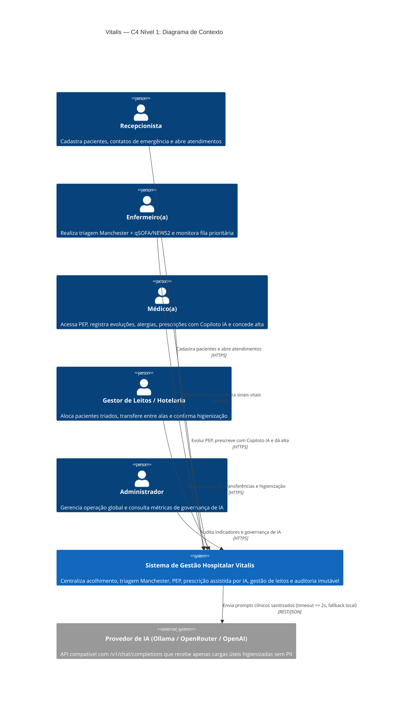
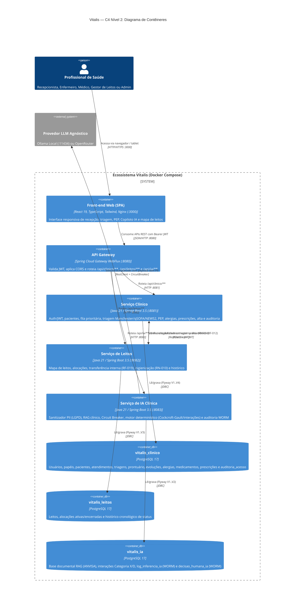
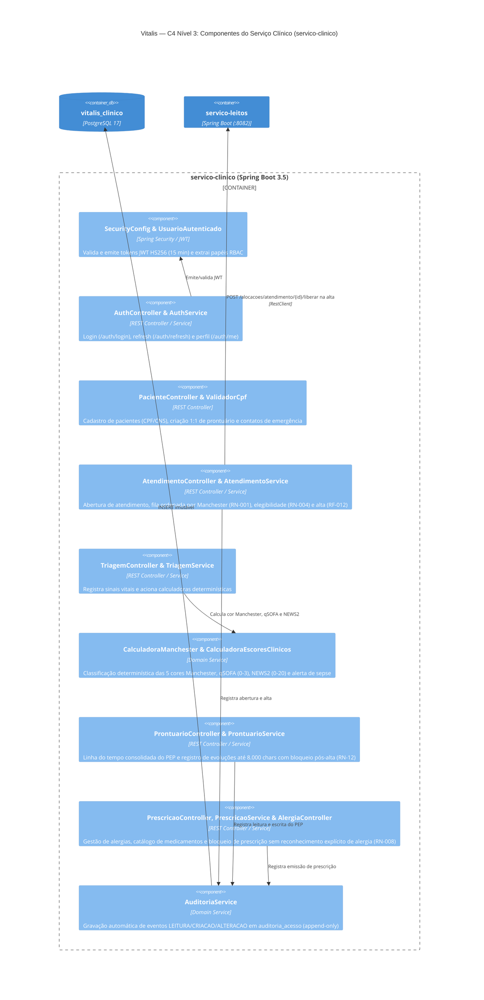
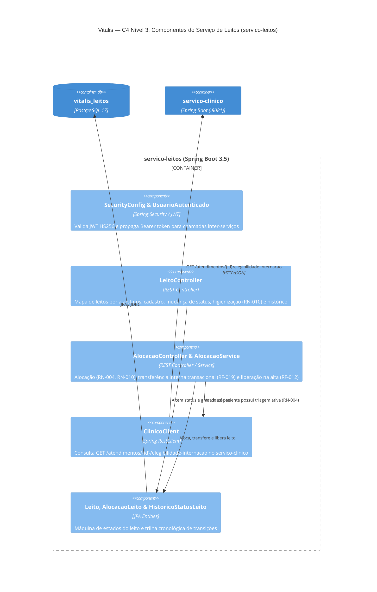
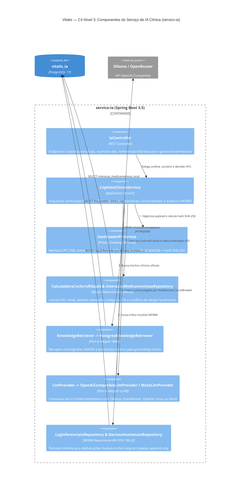
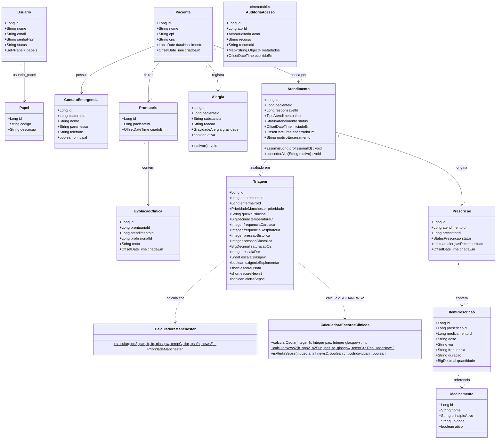

# Arquitetura do Vitalis — Modelo C4 Completo (Níveis 1 a 4)

O **Vitalis** é um sistema integrado de gestão hospitalar estruturado em **arquitetura de microsserviços** atrás de um **API Gateway**, com isolamento de dados por serviço (*database-per-service*) e módulo de **Inteligência Artificial Clínica** desacoplado por *Ports & Adapters* (agnóstico a modelo/provedor, com *Circuit Breaker*, sanitização de PII e contingência determinística local).

---

## 1. Stack Tecnológica

| Camada | Tecnologia | Papel na Arquitetura |
|---|---|---|
| **Linguagem (Back-end)** | Java 21 | Exigência da disciplina; records, pattern matching e tipagem forte |
| **Framework Back-end** | Spring Boot 3.5.7 | Microsserviços REST (`servico-clinico`, `servico-leitos`, `servico-ia`) |
| **API Gateway** | Spring Cloud Gateway (WebFlux) | Ponto único de entrada (`/api/**`), validação JWT e política de CORS |
| **Segurança** | Spring Security + OAuth2 Resource Server (JWT HS256) | Autenticação stateless (TTL 15 min + refresh) e RBAC por papel (`@PreAuthorize`) |
| **Resiliência (IA)** | Resilience4j Circuit Breaker | Proteção de chamadas de IA com timeout estrito e fallback determinístico |
| **Persistência & Migrações** | PostgreSQL 17 + Spring Data JPA + Flyway | 3 bancos isolados (`vitalis_clinico`, `vitalis_leitos`, `vitalis_ia`) em 3NF com triggers WORM (`append-only`) |
| **Front-end** | React 19 + TypeScript + Vite + Tailwind CSS + TanStack Query | SPA responsiva (desktop/tablet) servida via Nginx com polling reativo a cada 5s |
| **Orquestração** | Docker & Docker Compose | Subida unificada dos 6 contêineres com healthchecks encadeados |

---

## 2. C4 — Nível 1: Diagrama de Contexto

Mostra o sistema **Vitalis** como uma caixa-preta no centro, os 5 perfis de usuários hospitalares que interagem com ele e a integração externa/local com provedores de modelos de linguagem (LLMs).

---

## 3. C4 — Nível 2: Diagrama de Contêineres

Detalha as unidades de implantação (*containers* Docker), os três bancos de dados isolados no PostgreSQL 17 e as rotas de comunicação síncrona REST.

---

## 4. C4 — Nível 3: Diagrama de Componentes

### 4.1 Componentes do `servico-clinico`

### 4.2 Componentes do `servico-leitos`

### 4.3 Componentes do `servico-ia` (Agnóstico a Modelo/Provedor)

---

## 5. C4 — Nível 4: Diagramas de Código (Classes Implementadas)

### 5.1 Domínio Clínico (`br.ucsal.vitalis.clinico`)

### 5.2 Domínio de Leitos (`br.ucsal.vitalis.leitos`) e Serviço de IA (`br.ucsal.vitalis.ia`)

```mermaid
classDiagram
    class Leito {
        +Long id
        +String codigo
        +String ala
        +StatusLeito status
        +alterarStatus(StatusLeito novo) void
    }

    class AlocacaoLeito {
        +Long id
        +Long leitoId
        +Long atendimentoId
        +StatusAlocacao status
        +OffsetDateTime alocadoEm
        +OffsetDateTime liberadoEm
        +Long responsavelId
        +encerrar(OffsetDateTime instante) void
    }

    class HistoricoStatusLeito {
        +Long id
        +Long leitoId
        +Long alocacaoId
        +StatusLeito statusAnterior
        +StatusLeito statusNovo
        +Long atendimentoId
        +Long responsavelId
        +OffsetDateTime alteradoEm
    }

    class AlocacaoService {
        +alocar(NovaAlocacaoRequest req) AlocacaoLeito
        +transferir(Long alocacaoId, Long leitoDestinoId) AlocacaoLeito
        +liberarPorAtendimento(Long atendimentoId) LiberacaoResponse
    }

    class ClinicoClient {
        +verificarElegibilidadeInternacao(Long atendimentoId, String token) ElegibilidadeInternacaoResponse
    }

    class LlmProvider {
        <<interface>>
        +providerName() String
        +modelName() String
        +completar(LlmRequest request) LlmResponse
    }

    class OpenAiCompatibleLlmProvider {
        +completar(LlmRequest request) LlmResponse
    }

    class MockLlmProvider {
        +completar(LlmRequest request) LlmResponse
    }

    class KnowledgeRetriever {
        <<interface>>
        +buscar(List~String~ termos, int topK) List~TrechoClinico~
    }

    class PostgresKnowledgeRetriever {
        +buscar(List~String~ termos, int topK) List~TrechoClinico~
    }

    class SanitizadorPiiService {
        +sanitizarTexto(String texto, String nomePaciente) String
        +gerarTokenSessao(Long atendimentoId) String
        +hashSha256(String payload) String
    }

    class CalculadoraCockcroftGault {
        +calcular(Integer idade, Double peso, Double creatinina, String sexo)$ BigDecimal
        +exigeAjusteRenal(BigDecimal clcr)$ boolean
    }

    class CopilotoClinicoService {
        +analisarPrescricao(AnalisePrescricaoRequest req) Map
        +gerarSumarioAlta(SumarioAltaRequest req) Map
        +registrarDecisaoHitl(Long inferenciaId, DecisaoHitlRequest req) DecisaoHumanaIa
        +metricasGovernanca() Map
    }

    class LogInferenciaIa {
        <<Immutable>>
        +Long id
        +Long atendimentoId
        +Long usuarioId
        +ModuloIa moduloIa
        +String provedorIa
        +String modeloIaVersao
        +String promptSanitizadoHash
        +boolean modoContingenciaAtivo
        +Map~String,Object~ respostaIa
    }

    class DecisaoHumanaIa {
        <<Immutable>>
        +Long id
        +Long logInferenciaId
        +Long usuarioId
        +DecisaoMedica decisaoMedica
        +String justificativaHumana
        +OffsetDateTime decididoEm
    }

    Leito "1" --> "*" AlocacaoLeito : recebe
    Leito "1" --> "*" HistoricoStatusLeito : registra
    AlocacaoService --> Leito : gerencia
    AlocacaoService --> AlocacaoLeito : cria/encerra
    AlocacaoService --> ClinicoClient : valida RN-004
    OpenAiCompatibleLlmProvider ..|> LlmProvider
    MockLlmProvider ..|> LlmProvider
    PostgresKnowledgeRetriever ..|> KnowledgeRetriever
    CopilotoClinicoService --> LlmProvider : usa via CircuitBreaker
    CopilotoClinicoService --> KnowledgeRetriever : consulta RAG
    CopilotoClinicoService --> SanitizadorPiiService : remove PII
    CopilotoClinicoService ..> CalculadoraCockcroftGault : calcula ClCr
    CopilotoClinicoService --> LogInferenciaIa : persiste WORM
    CopilotoClinicoService --> DecisaoHumanaIa : registra HITL
    DecisaoHumanaIa "0..1" --> "1" LogInferenciaIa : delibera sobre
```

---

## 6. Catálogo Completo de Endpoints (via API Gateway)

| Serviço | Método | Rota no Gateway | Papéis Permitidos | Requisito / Regra |
|---|---|---|---|---|
| **Clínico** | `POST` | `/api/clinico/auth/login` | Público | RF-001 (JWT 15m + Refresh) |
| **Clínico** | `POST` | `/api/clinico/auth/refresh` | Público | RNF-011 (Renovação de sessão) |
| **Clínico** | `GET` | `/api/clinico/auth/me` | Autenticado | RF-001 (Sessão atual) |
| **Clínico** | `GET` | `/api/clinico/pacientes?q=` | Autenticado | RF-002 (Busca por nome/CPF) |
| **Clínico** | `POST` | `/api/clinico/pacientes` | `RECEPCIONISTA`, `ENFERMEIRO`, `MEDICO`, `ADMINISTRADOR` | RF-002 (Valida CPF/CNS + cria PEP) |
| **Clínico** | `GET/POST/DELETE` | `/api/clinico/pacientes/{id}/contatos-emergencia` | `RECEPCIONISTA`, `ENFERMEIRO`, `MEDICO`, `ADMINISTRADOR` | RF-002 (Contatos de emergência) |
| **Clínico** | `POST` | `/api/clinico/atendimentos` | `RECEPCIONISTA`, `ENFERMEIRO`, `MEDICO`, `ADMINISTRADOR` | Abertura de episódio clínico |
| **Clínico** | `GET` | `/api/clinico/atendimentos/fila` | Autenticado | RN-001 (Fila prioritária: Vermelho no topo) |
| **Clínico** | `PATCH` | `/api/clinico/atendimentos/{id}/assumir` | `ENFERMEIRO`, `MEDICO`, `ADMINISTRADOR` | Assumir atendimento ativo |
| **Clínico** | `GET` | `/api/clinico/atendimentos/{id}/elegibilidade-internacao` | Autenticado (inter-serviço) | RN-004 (Verifica triagem prévia) |
| **Clínico** | `POST` | `/api/clinico/atendimentos/{id}/alta` | `MEDICO`, `ADMINISTRADOR` | RF-012 / RN-12 (Alta + libera leito) |
| **Clínico** | `GET/POST` | `/api/clinico/atendimentos/{id}/triagens` | `ENFERMEIRO`, `MEDICO`, `ADMINISTRADOR` | RF-003 / RF-004(OV) (Manchester + qSOFA + NEWS2) |
| **Clínico** | `GET` | `/api/clinico/pacientes/{id}/prontuario` | `ENFERMEIRO`, `MEDICO`, `ADMINISTRADOR` | RF-005 / RNF-004 (PEP + Auditoria `LEITURA`) |
| **Clínico** | `POST` | `/api/clinico/pacientes/{id}/prontuario/evolucoes` | `ENFERMEIRO`, `MEDICO`, `ADMINISTRADOR` | RF-010 / RN-12 (Evolução até 8000 chars) |
| **Clínico** | `GET/POST/PATCH` | `/api/clinico/pacientes/{id}/alergias` | `ENFERMEIRO`, `MEDICO`, `ADMINISTRADOR` | RF-018 (Cadastro e inativação de alergias) |
| **Clínico** | `GET/POST` | `/api/clinico/medicamentos` | Autenticado / `MEDICO`, `FARMACEUTICO`, `ADMINISTRADOR` | Catálogo farmacológico |
| **Clínico** | `GET/POST` | `/api/clinico/atendimentos/{id}/prescricoes` | `MEDICO`, `ADMINISTRADOR` | RF-006 / RN-008 (Reconhecimento de alergia) |
| **Leitos** | `GET` | `/api/leitos/leitos?status=&ala=` | Autenticado | RF-004 (Mapa visual com alocação ativa) |
| **Leitos** | `POST` | `/api/leitos/leitos` | `GESTOR_LEITOS`, `ADMINISTRADOR` | Cadastro de leito |
| **Leitos** | `PATCH` | `/api/leitos/leitos/{id}/status` | `GESTOR_LEITOS`, `ENFERMEIRO`, `ADMINISTRADOR` | RN-010 (Bloqueia ocupar `EM_HIGIENIZACAO`) |
| **Leitos** | `PATCH` | `/api/leitos/leitos/{id}/higienizar` | `GESTOR_LEITOS`, `ADMINISTRADOR` | RN-010 (`EM_HIGIENIZACAO` → `LIVRE`) |
| **Leitos** | `GET` | `/api/leitos/leitos/{id}/historico` | Autenticado | Histórico cronológico de status |
| **Leitos** | `POST` | `/api/leitos/alocacoes` | `GESTOR_LEITOS`, `MEDICO`, `ENFERMEIRO`, `ADMINISTRADOR` | RN-004 / RN-010 (Alocar paciente triado) |
| **Leitos** | `POST` | `/api/leitos/alocacoes/{id}/transferir` | `GESTOR_LEITOS`, `MEDICO`, `ENFERMEIRO`, `ADMINISTRADOR` | RF-019 (Transferência interna transacional) |
| **Leitos** | `POST` | `/api/leitos/alocacoes/atendimento/{id}/liberar` | `MEDICO`, `GESTOR_LEITOS`, `ADMINISTRADOR` | RF-012 (Liberação automática na alta) |
| **IA** | `POST` | `/api/ia/copiloto/prescricao` | `MEDICO`, `ADMINISTRADOR` | RF-008 / RF-018 / RF-020 (RAG + PII + Circuit Breaker) |
| **IA** | `POST` | `/api/ia/sumario-alta` | `MEDICO`, `ADMINISTRADOR` | RF-011 (Minuta estruturada de alta) |
| **IA** | `POST` | `/api/ia/inferencias/{id}/decisao` | `MEDICO`, `ENFERMEIRO`, `ADMINISTRADOR` | RF-019 / RN-2 (Deliberação HITL em WORM) |
| **IA** | `GET` | `/api/ia/governanca/metricas` | `ADMINISTRADOR`, `MEDICO` | RF-019 (Indicadores de governança e aceite) |
