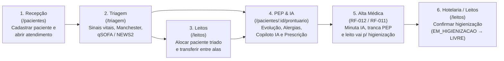

# Guia Passo a Passo de Navegação — Plataforma Vitalis

Este guia foi criado para que todos os integrantes da equipe conheçam o funcionamento completo do **Vitalis**, saibam navegar por todas as telas conforme cada perfil profissional e tenham um **roteiro pronto para demonstração ponta a ponta**.

---

## 1. Visão Geral do Fluxo Hospitalar

---

## 2. Acesso e Perfis de Usuário (Login e RBAC)

1. Com o projeto rodando (`docker compose up -d`), abra no navegador: **`http://localhost:3000`**.
2. Na tela de login (`/login`), você pode:
   - Digitar e-mail e senha manualmente (senha padrão de todos os usuários demo: **`Vitalis@2026`**), **ou**
   - Clicar em um dos **botões de acesso rápido** para testar cada perfil na hora.

### O que cada perfil pode fazer

| Perfil | E-mail | Tela Inicial | Permissões Principais |
|---|---|---|---|
| **Recepcionista** | `recepcao@vitalis.local` | `/pacientes` | Cadastrar pacientes, contatos de emergência e abrir atendimentos. |
| **Enfermeiro** | `enfermeiro@vitalis.local` | `/triagem` | Realizar triagem Manchester + qSOFA/NEWS2, assumir atendimento, registrar evoluções/alergias e alocar leitos. |
| **Médico** | `medico@vitalis.local` | `/triagem` | Tudo do PEP: evoluções, alergias, prescrições, **Copiloto IA (RAG + HITL)**, **Minuta de Alta IA** e **Dar Alta Médica**. |
| **Gestor de Leitos** | `leitos@vitalis.local` | `/leitos` | Cadastrar leitos, alocar pacientes, realizar transferências internas e confirmar higienização (`EM_HIGIENIZACAO` → `LIVRE`). |
| **Administrador** | `admin@vitalis.local` | `/pacientes` | Acesso irrestrito a todas as telas e métricas de governança de IA. |

> **Expiração de sessão (RNF-011):** o token de acesso expira a cada **15 minutos** e é renovado automaticamente em segundo plano enquanto a sessão estiver ativa. Para trocar de perfil, clique em **Sair** no menu lateral/topo.

---

## 3. Navegação Tela a Tela (Roteiro Completo)

### Etapa 1 — Recepção e Pacientes (`/pacientes`)
**Perfil recomendado:** `Recepcionista` (`recepcao@vitalis.local`)

1. **Pesquisar pacientes:** use o campo de busca no topo para filtrar por **nome** ou **CPF**. O sistema já vem com 2 pacientes de exemplo (*João Carlos da Silva* e *Maria Eduarda Oliveira*).
2. **Cadastrar novo paciente:** clique em **`Novo Paciente`**, preencha Nome, CPF (**apenas 11 dígitos válidos** — CPFs inválidos são rejeitados automaticamente), CNS opcional (15 dígitos) e Data de Nascimento.
   - Ao cadastrar, o sistema cria automaticamente o **Prontuário Eletrônico (PEP)** do paciente.
3. **Contatos de Emergência:** clique no botão de **Contatos** de qualquer paciente para adicionar ou remover familiares/responsáveis.
4. **Abrir Atendimento:** clique em **`Abrir Atendimento`** no cartão/linha do paciente, escolha o tipo (**Emergência**, **Hospitalar** ou **Ambulatorial**) e confirme.
   - O paciente entra imediatamente na fila de triagem.

---

### Etapa 2 — Fila Prioritária e Triagem (`/triagem`)
**Perfil recomendado:** `Enfermeiro` (`enfermeiro@vitalis.local`)

1. A tela atualiza automaticamente a cada **5 segundos** (polling).
2. Localize o paciente com selo **Sem Triagem** e clique em **`Realizar Triagem`**.
3. Preencha a **Queixa Principal** e os **Sinais Vitais**:
   - Temperatura (°C), Frequência Cardíaca (bpm), Frequência Respiratória (rpm), Pressão Arterial (Sistólica/Diastólica), Saturação O₂ (%), Escala de Dor (0–10), Escala de Glasgow (3–15) e se usa Oxigênio Suplementar.
4. **Preview em tempo real:** conforme você digita, o formulário calcula instantaneamente:
   - **Classificação de Manchester** (`Vermelha`, `Laranja`, `Amarela`, `Verde`, `Azul`);
   - **qSOFA (0 a 3)** e **NEWS2 (0 a 20)**;
   - **Alerta de Sepse** quando `qSOFA ≥ 2`, `NEWS2 ≥ 7` ou algum parâmetro individual atinge 3 pontos.
5. **Teste da Prioridade Vermelha (RN-001):**
   - Experimente lançar sinais críticos (ex.: `FR = 26`, `PAS = 88`, `SpO2 = 89`, `Glasgow = 13`, `O2 suplementar = Sim`).
   - Ao salvar, o paciente sobe **automaticamente para o topo da fila** (ignorando ordem de chegada), exibindo faixa vermelha de emergência e aviso sonoro (que pode ser ativado/silenciado no botão de som).

---

### Etapa 3 — Mapa Visual de Leitos (`/leitos`)
**Perfil recomendado:** `Gestor de Leitos` (`leitos@vitalis.local`)

1. Os leitos aparecem agrupados por **Ala** (*UTI Adulto*, *Clínica Médica*, *Emergência*, *Cirúrgica*, *Isolamento*) e atualizam automaticamente a cada **5 segundos**.
2. **Cores de status:**
   - Verde: `LIVRE` | Azul: `OCUPADO` | Azul claro: `RESERVADO` | Âmbar: `EM_HIGIENIZACAO` | Cinza: `MANUTENCAO` | Roxo: `ISOLAMENTO`.
3. **Alocar Paciente (RN-004):**
   - Em um leito `LIVRE`, clique em **`Alocar`** e escolha um atendimento da lista.
   - *Regra RN-004:* se você escolher um atendimento marcado como `(SEM TRIAGEM)`, o back-end bloqueia com aviso claro (**HTTP 422**) exigindo triagem prévia.
   - Escolhendo um atendimento já triado, o leito muda para `OCUPADO`.
4. **Transferência Interna (RF-019):**
   - Em um leito `OCUPADO`, clique em **`Transferir`** e selecione um leito de destino `LIVRE`.
   - Automaticamente, o leito de **origem** muda para `EM_HIGIENIZACAO` e o de **destino** para `OCUPADO`.
5. **Confirmar Higienização (RN-010):**
   - Leitos em `EM_HIGIENIZACAO` **não podem ser alocados** até que o Gestor de Leitos clique em **`Liberar`** e confirme no modal (transição para `LIVRE`).
6. **Histórico:** clique no ícone de relógio em qualquer leito para ver todas as transições auditadas.

---

### Etapa 4 — Prontuário Eletrônico (PEP), Prescrição e Copiloto IA (`/pacientes/:id/prontuario`)
**Perfil recomendado:** `Médico` (`medico@vitalis.local`)

Acesse clicando em **Prontuário** a partir da tela `/pacientes` ou `/triagem`.

1. **Cabeçalho e Faixa de Alergias (RF-018):**
   - Se o paciente possuir alergias ativas (ex.: *João Carlos da Silva* tem alergia **GRAVE** a *Penicilinas / Amoxicilina*), uma **faixa vermelha destacada** aparece no topo do prontuário.
   - Se o paciente não tiver atendimento aberto, clique em **`Abrir Atendimento Agora`** no banner azul no topo.
   - Toda abertura do prontuário grava um evento de `LEITURA` na tabela imutável `auditoria_acesso`.

2. **Aba `Linha do Tempo`:**
   - Consolida cronologicamente todas as **Evoluções Clínicas**, **Triagens** (com badges qSOFA/NEWS2/Sepse) e **Prescrições** do paciente.

3. **Aba `Nova Evolução` (RF-010):**
   - Digite a nota clínica (suporte de até **8.000 caracteres** com contador em tempo real) e clique em **`Salvar Evolução`**.

4. **Aba `Alergias`:**
   - Permite registrar novas alergias (substância, gravidade e reação) ou inativar uma alergia existente.

5. **Aba `Nova Prescrição` + Copiloto IA (RF-006 / RF-008 / RN-008 / RN-2 / RN-4):**
   - Selecione um ou mais medicamentos (ex.: *Amoxicilina 500mg* ou *Meropenem 1g*), informe dose, via, frequência e quantidade.
   - **Consultar Copiloto IA (RAG):**
     - Clique em **`Consultar Copiloto IA (RAG)`**.
     - O sistema sanitiza dados pessoais (LGPD — sem enviar CPF/nome ao modelo), busca trechos oficiais na base RAG (bulário ANVISA), executa verificações determinísticas (alergias, interações Categoria X/D e ajuste renal) e exibe o **Parecer Consultivo**.
     - No topo direito do cartão aparece qual provedor/modelo respondeu (ex.: `ollama • qwen2.5:7b-instruct-q5_K_M`) e a latência. Se o LLM estiver indisponível ou estourar o timeout, o **Circuit Breaker** exibe o banner amarelo de **Modo de Contingência Determinística Ativo** sem travar a tela.
     - **Deliberação Human-in-the-Loop (RN-2):** clique em **`Aceitar Recomendação`**, **`Modificar Conduta`** ou **`Rejeitar Alerta`** (modificar/rejeitar exige justificativa clínica com pelo menos 10 caracteres). A decisão é gravada em trilha imutável WORM.
   - **Confirmar Prescrição (RN-008):**
     - Clique em **`Confirmar Prescrição`**.
     - Se o paciente tiver alergias ativas, o sistema **bloqueia o envio direto** e abre um **modal vermelho obrigatório** exigindo reconhecimento explícito das alergias antes de concluir.

---

### Etapa 5 — Alta Médica e Ciclo Final (RF-012 / RF-011 / RN-12)
**Perfil recomendado:** `Médico` → depois `Gestor de Leitos`

1. No topo direito do Prontuário, clique em **`Dar Alta Médica`**.
2. No modal de confirmação, clique em **`Gerar Minuta com IA (RF-011)`** para preencher automaticamente o sumário de alta a partir das evoluções e prescrições anonimizadas. Revise ou edite o texto.
3. Clique em **`Confirmar Alta Médica`**. O sistema executa automaticamente:
   - Encerra o atendimento com status `ALTA`;
   - **Tranca o prontuário daquele episódio (RN-12):** novas evoluções e prescrições ficam bloqueadas naquele atendimento;
   - **Comunica o `servico-leitos`:** se o paciente estava internado em um leito, a alocação é encerrada e o leito passa automaticamente para **`EM_HIGIENIZACAO`**.
4. Troque para o perfil **`Gestor de Leitos`** (`leitos@vitalis.local`), abra `/leitos` e clique em **`Liberar`** no leito em higienização para devolvê-lo ao status **`LIVRE`**.

---

## 4. Checklist Rápido para Apresentação da Equipe

Se a equipe dividir a demonstração por integrante, esta divisão cobre 100% dos requisitos em ~5 minutos:

| Integrante / Papel | O que demonstrar na tela | Requisitos / RNs comprovados |
|---|---|---|
| **Recepção** | Cadastrar paciente (mostrar validação de CPF), adicionar contato e abrir atendimento | RF-001, RF-002 |
| **Enfermagem** | Fazer triagem com sinais críticos → paciente vai ao topo como **Vermelho** com qSOFA/NEWS2/Sepse | RF-003, RF-004(OV), RN-001 |
| **Gestão de Leitos** | Mostrar bloqueio sem triagem, alocar leito, transferir paciente e confirmar higienização | RF-004, RF-019, RN-004, RN-010 |
| **Medicina (PEP)** | Abrir PEP (faixa de alergia), registrar evolução, testar bloqueio de alergia na prescrição | RF-005, RF-006, RF-010, RF-018, RN-008 |
| **IA Clínica & Alta** | Consultar Copiloto IA (RAG + HITL), gerar Minuta de Alta IA, dar alta (leito → higienização e PEP trancado) | RF-008, RF-011, RF-012, RF-018/019/020, RN-2, RN-4, RN-12 |

---

## 5. Dúvidas Comuns

- **O botão "Consultar Copiloto IA" ou "Salvar Evolução" está desabilitado?**
  - Verifique se: (1) você está logado como **Médico** ou **Admin**, (2) existe um **atendimento aberto** (clique em `Abrir Atendimento Agora` no topo do prontuário se aparecer o banner azul), e (3) há ao menos **1 medicamento selecionado** na prescrição.
- **Como resetar todos os dados para começar uma demonstração limpa?**
  - Rode `docker compose down -v && docker compose up -d` na raiz do projeto. Os bancos são recriados do zero com os dados demo em poucos segundos.
