# Catálogo de Telas e Fluxos Assistenciais — Sistema Vitalis

Este documento apresenta as **capturas de tela reais** da aplicação **Vitalis** em execução, cobrindo todos os fluxos funcionais e regras de negócio exigidos para a entrega da **II Unidade** (Item 13 — Telas do Front-End).

---

## 1. Autenticação e Controle de Acesso por Papel (RF-001 / RNF-011)

A tela inicial de login oferece autenticação via JWT (com expiração de sessão de 15 minutos e renovação automática), além de **atalhos de demonstração rápida** para os 5 perfis do sistema (`Admin`, `Recepcionista`, `Enfermeiro`, `Médico` e `Gestor de Leitos`).

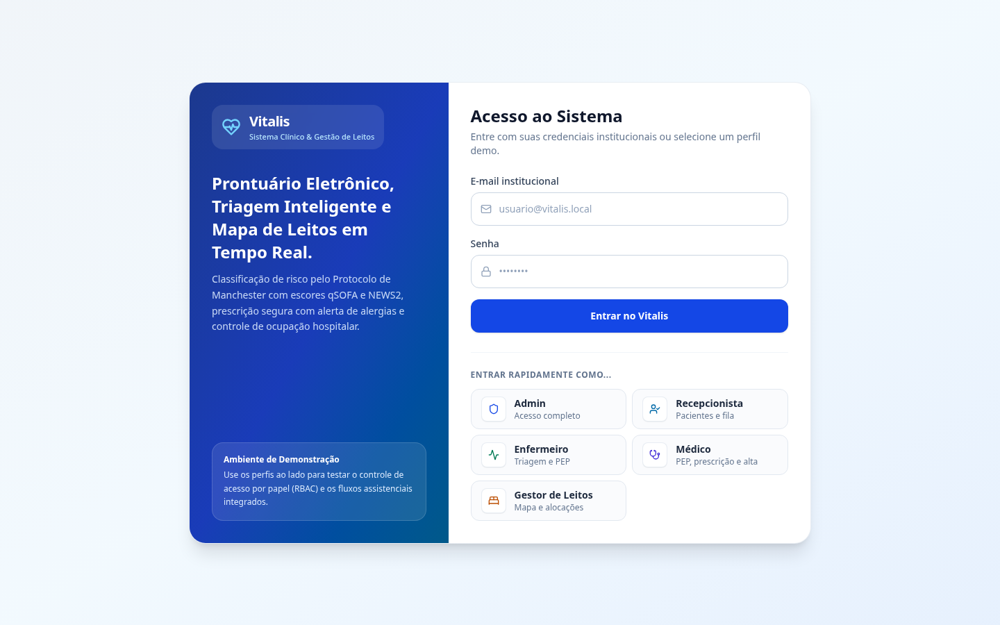

---

## 2. Recepção, Cadastro de Pacientes e Abertura de Atendimento (RF-002)

### 2.1 Listagem e Busca de Pacientes (`/pacientes`)
Permite pesquisar pacientes por nome, CPF ou CNS em tempo real, acessar contatos de emergência, abrir novos atendimentos ou navegar diretamente para o Prontuário Eletrônico (PEP).

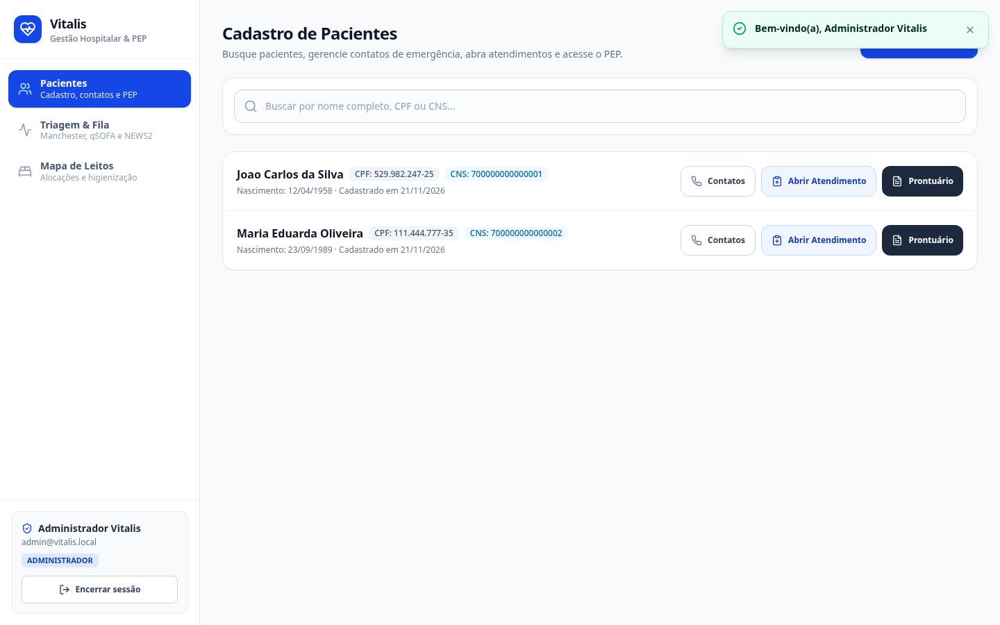

### 2.2 Modal de Cadastro de Novo Paciente
Valida dígitos verificadores do CPF, unicidade cadastral e formato de 15 dígitos do Cartão Nacional de Saúde (CNS), criando automaticamente o Prontuário Eletrônico 1:1 do paciente.

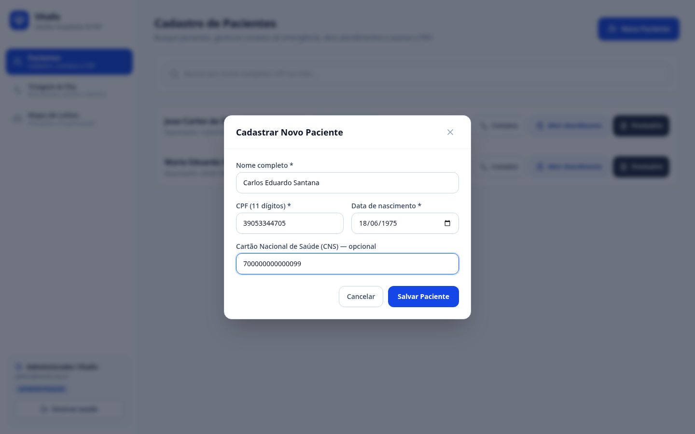

### 2.3 Gestão de Contatos de Emergência
Cadastro e consulta de familiares ou responsáveis legais vinculados ao paciente, destacando o contato principal.

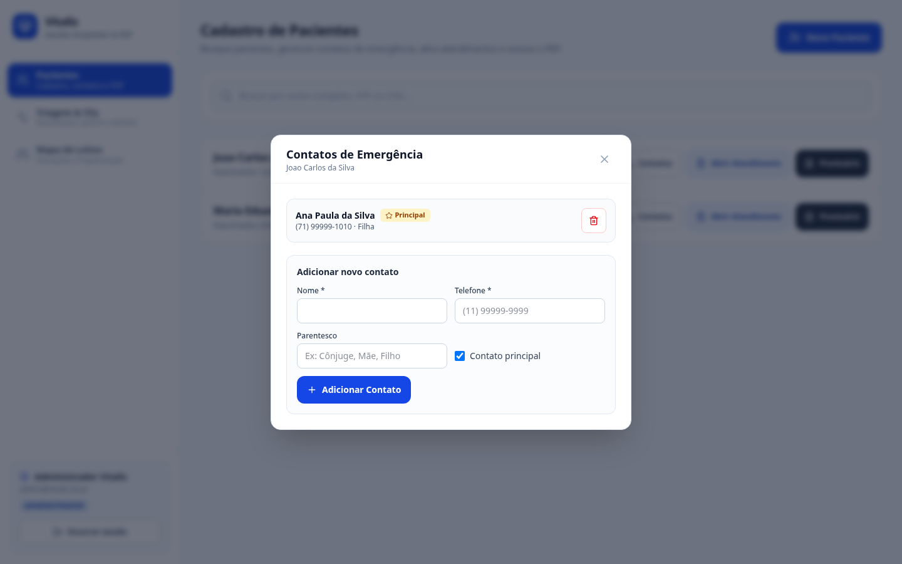

### 2.4 Abertura de Atendimento Clínico
Encaminha o paciente para a fila assistencial na modalidade **Emergência**, **Hospitalar / Internação** ou **Ambulatorial**.

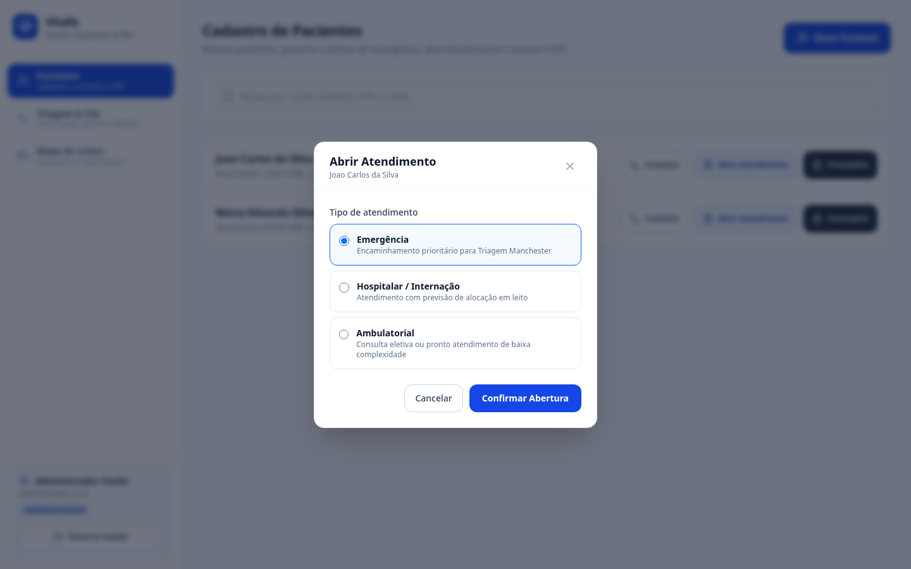

---

## 3. Triagem Manchester, Escores qSOFA/NEWS2 e Fila de Emergência (RF-003 / RF-004 / RN-001)

### 3.1 Formulário de Triagem com Prévia Instantânea de Manchester, qSOFA e NEWS2
Enquanto o enfermeiro preenche os sinais vitais (Temperatura, FC, FR, PAS/PAD, SpO₂, Dor, Glasgow e O₂ suplementar), o sistema calcula deterministicamente em tempo real:
- A cor do **Protocolo de Manchester** (`Vermelha`, `Laranja`, `Amarela`, `Verde` ou `Azul`);
- O escore **qSOFA (0 a 3)** e o escore **NEWS2 (0 a 20)**;
- O alerta imediato de **Suspeita de Sepse**.

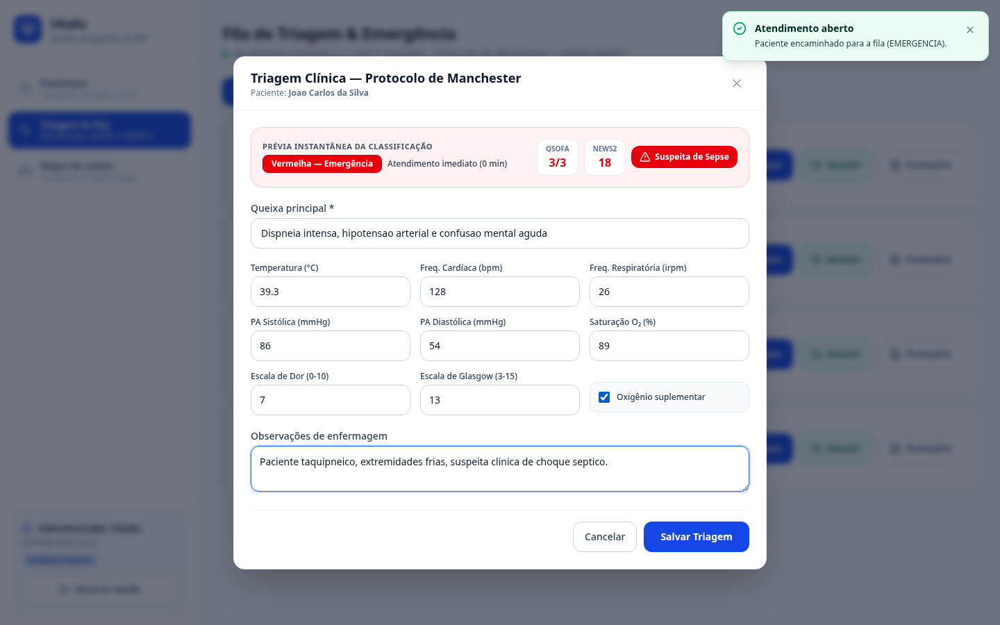

### 3.2 Fila Prioritária com Alerta Vermelho no Topo (`/triagem` — RN-001 / RF-021)
Pacientes classificados com prioridade **VERMELHA (Emergência)** são posicionados automaticamente no topo da fila (ignorando a ordem cronológica de chegada), acionando o **Banner Vermelho de Emergência Imediata**, o badge **`ALERTA SEPSE`** e o alerta sonoro via Web Audio API.

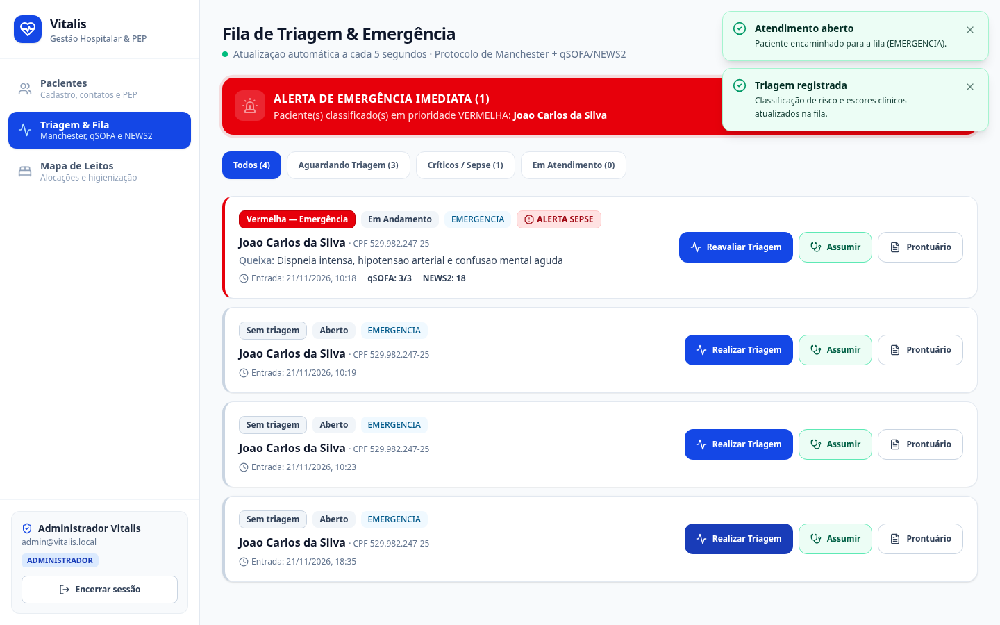

---

## 4. Mapa Visual e Gestão de Leitos Hospitalares (`/leitos` — RF-004 / RF-019 / RN-004 / RN-010)

### 4.1 Mapa de Leitos Agrupado por Ala em Tempo Real
Exibe os leitos separados por ala (*UTI Adulto*, *Clínica Médica*, *Cirúrgica*, *Emergência*, *Isolamento*) com atualização automática a cada 5 segundos e cores semânticas por status (`LIVRE`, `OCUPADO`, `RESERVADO`, `EM_HIGIENIZACAO`, `MANUTENCAO`, `ISOLAMENTO`).

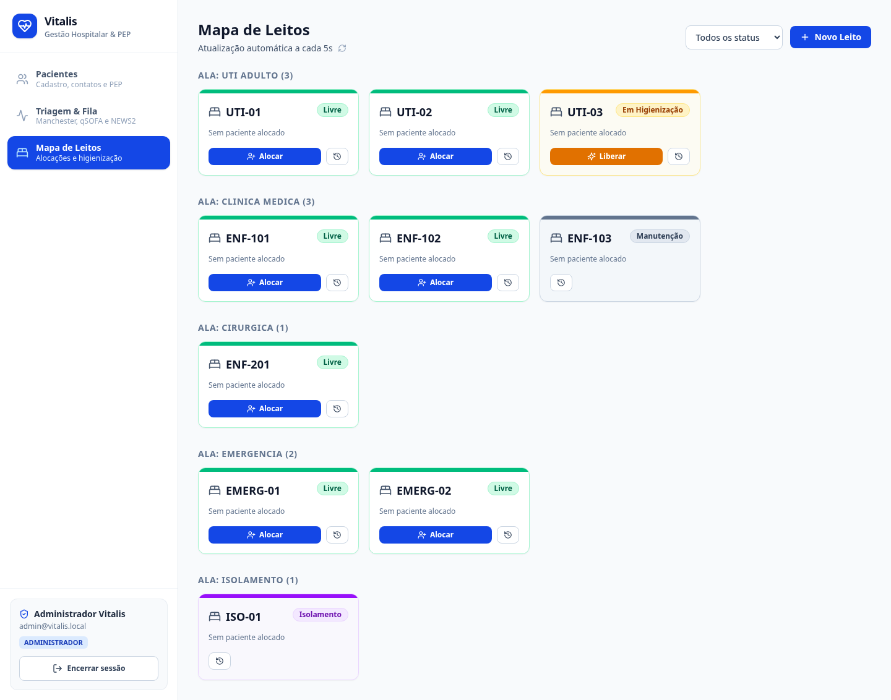

### 4.2 Alocação de Paciente com Validação de Triagem Prévia (RN-004)
Permite vincular um atendimento ativo a um leito `LIVRE`. O microsserviço `servico-leitos` consulta sincronamente o `servico-clinico` e bloqueia (**HTTP 422**) qualquer tentativa de internar paciente que ainda não tenha passado pela triagem.

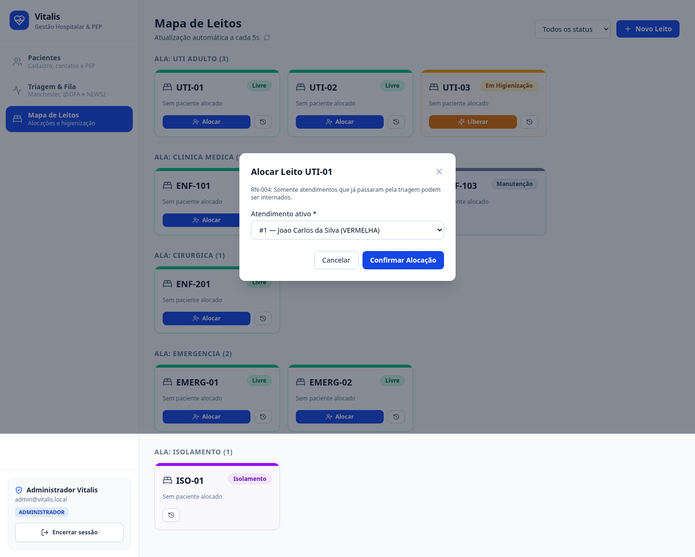

### 4.3 Transferência Interna entre Leitos (RF-019)
Transfere o paciente para um novo leito `LIVRE` em uma única transação: o leito de **origem** muda automaticamente para **`EM_HIGIENIZACAO`** e o leito de **destino** passa para **`OCUPADO`**.

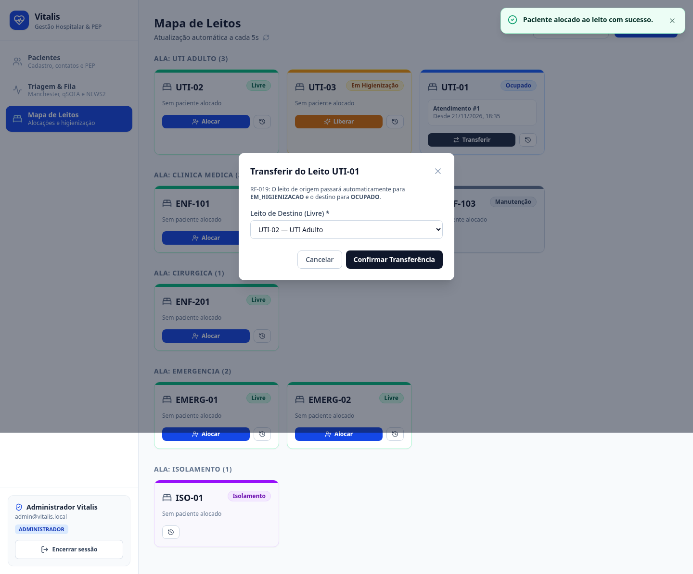

### 4.4 Histórico Auditável de Transições e Higienização (RN-010)
Registra todas as mudanças de estado do leito com data/hora e atendimento associado. Leitos em `EM_HIGIENIZACAO` permanecem bloqueados para novas ocupações até a confirmação de limpeza pela hotelaria.

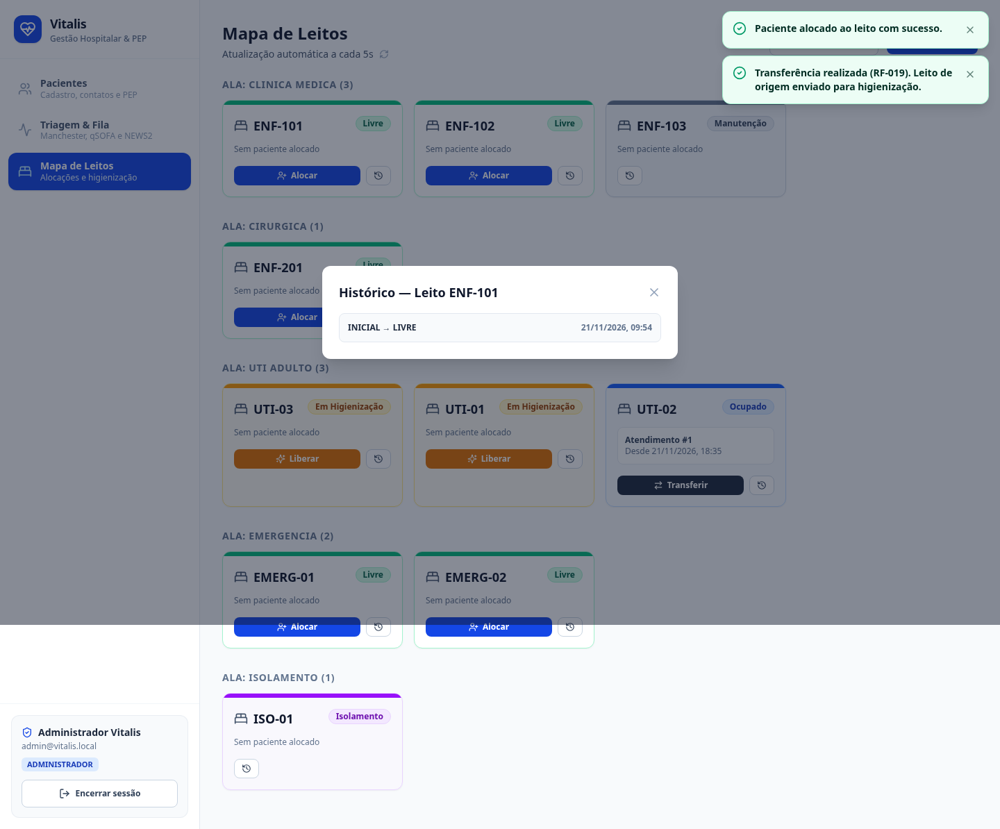

---

## 5. Prontuário Eletrônico (PEP), Prescrição Segura e Copiloto de IA (`/pacientes/:id/prontuario`)

### 5.1 Linha do Tempo Consolidada e Faixa de Alergias Ativas (RF-005 / RF-018 / RNF-004)
Ao abrir o PEP, o sistema grava automaticamente um registro imutável de auditoria (`LEITURA` em `auditoria_acesso`), exibe no topo a **Faixa Vermelha de Alergias Ativas** e organiza cronologicamente as Evoluções Clínicas, Triagens e Prescrições.

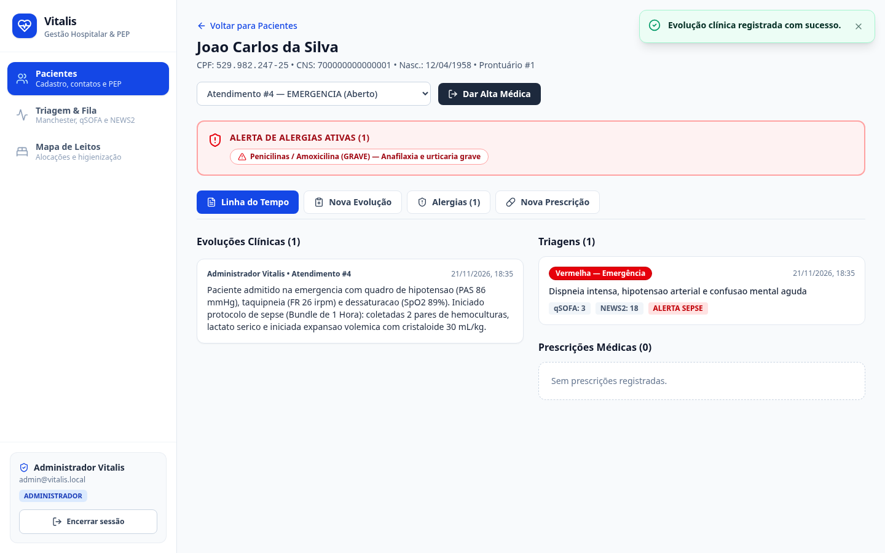

### 5.2 Registro de Evolução Clínica (RF-010)
Editor de evolução clínica com contador em tempo real para até **8.000 caracteres**, vinculado ao profissional autenticado e ao atendimento ativo.

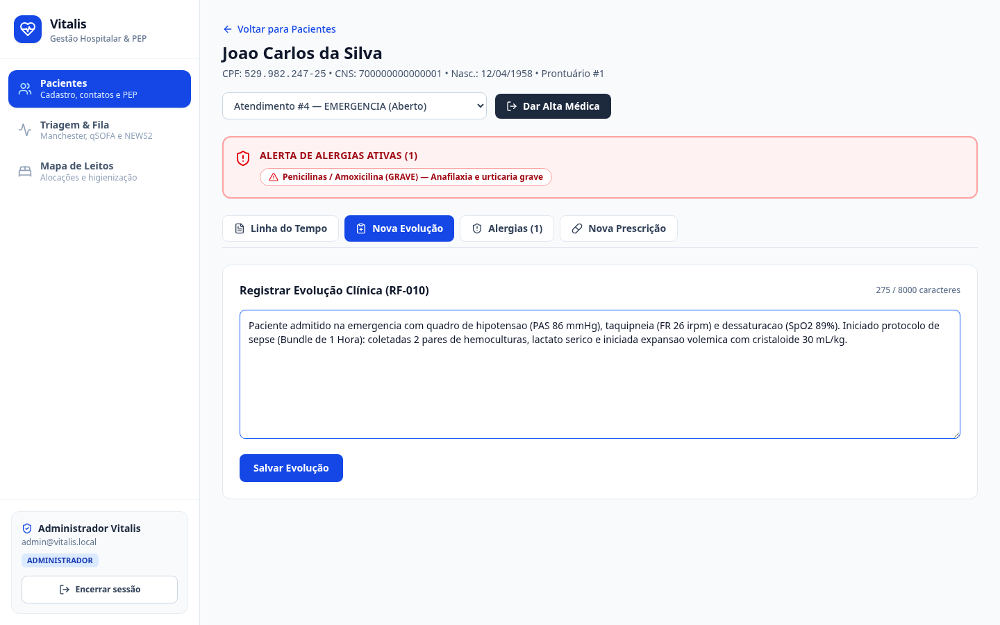

### 5.3 Gestão de Alergias e Contraindicações (RF-018)
Cadastro e inativação auditada de alergias classificadas por gravidade (`GRAVE`, `MODERADA`, `LEVE`, `NAO_INFORMADA`).

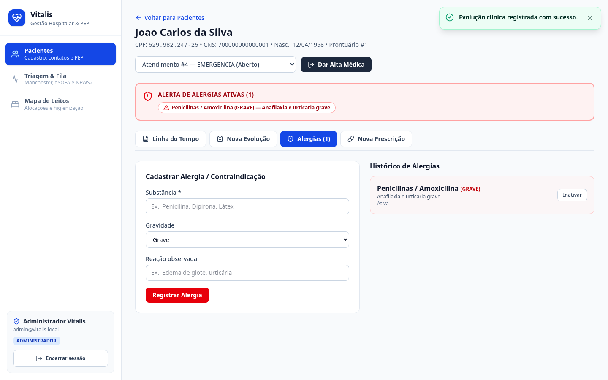

### 5.4 Prescrição Médica Assistida pelo Copiloto de IA com RAG e HITL (RF-006 / RF-008 / RN-2 / RN-3 / RN-4)
Antes de confirmar a prescrição, o médico aciona **`Consultar Copiloto IA (RAG)`**:
- Os dados identificáveis (PII) são removidos pelo gateway de privacidade (**RF-018 / RN-3**);
- O serviço recupera monografias oficiais da ANVISA (RAG), executa verificações determinísticas (veto de alergia, interações Categoria X/D e cálculo renal de Cockcroft-Gault) e consulta o provedor LLM agnóstico (**Ollama / OpenRouter**) protegido por **Circuit Breaker** (**RF-020 / RN-4**);
- O médico registra sua deliberação soberana **Human-in-the-Loop (RN-2)**: `Aceitar Recomendação`, `Modificar Conduta` ou `Rejeitar Alerta`, persistida na tabela imutável WORM `decisao_humana_ia`.

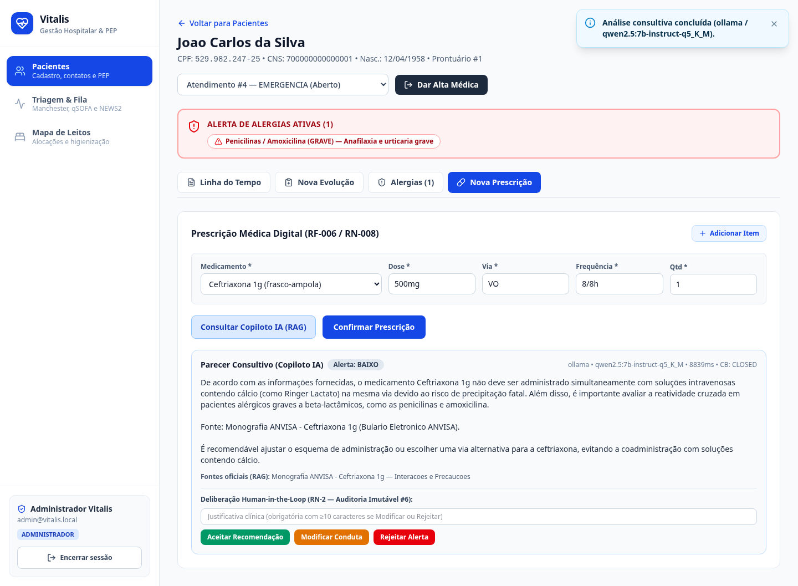

### 5.5 Bloqueio Obrigatório de Reconhecimento de Alergia na Prescrição (RN-008)
Ao confirmar uma prescrição para paciente com alergia ativa cadastrada, o sistema exige a confirmação expressa em modal de segurança antes de gravar a prescrição.

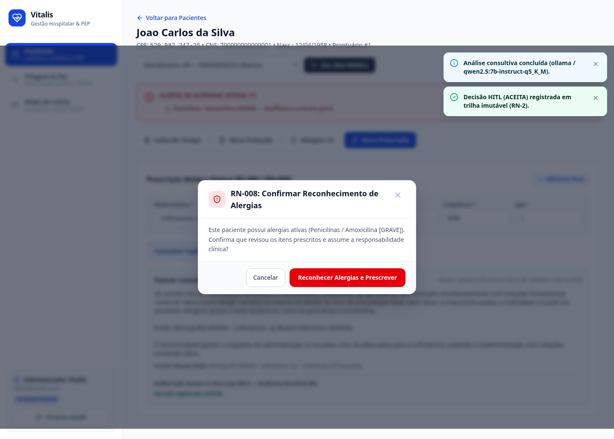

---

## 6. Fluxo de Alta Hospitalar com Minuta por IA e Trancamento do PEP (RF-011 / RF-012 / RN-12)

### 6.1 Modal de Alta Médica com Geração de Minuta por IA (RF-011 / RF-012)
O botão **`Gerar Minuta com IA (RF-011)`** sintetiza uma minuta estruturada de sumário de alta a partir das evoluções e prescrições do atendimento, mantendo a revisão médica obrigatória antes da confirmação.

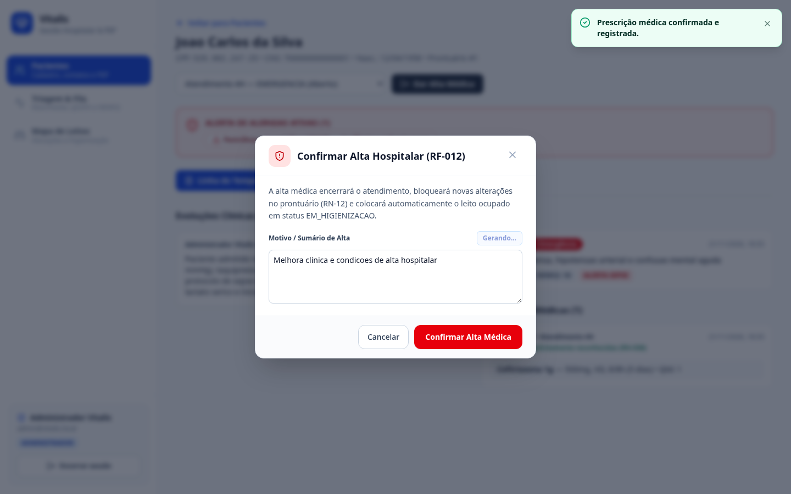

### 6.2 Prontuário Encerrado e Imutabilidade Pós-Alta (RN-12)
Confirmada a alta médica, o `servico-clinico` libera automaticamente o leito no `servico-leitos` para o estado **`EM_HIGIENIZACAO`** e **bloqueia permanentemente novas evoluções ou prescrições** naquele episódio de atendimento (**RN-12**).

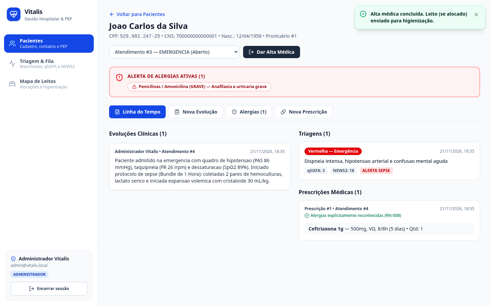
